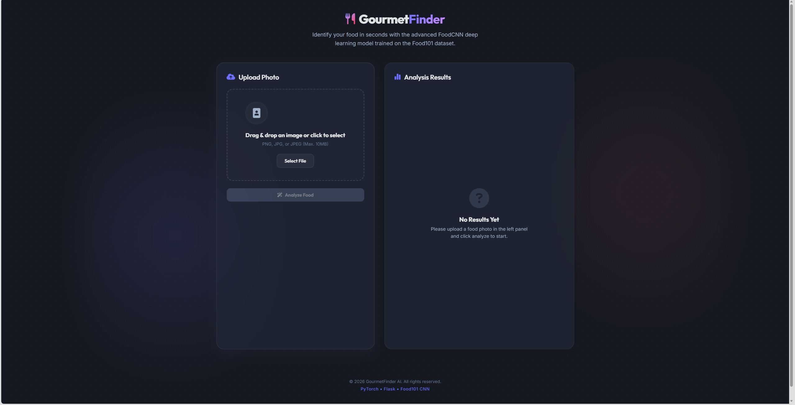
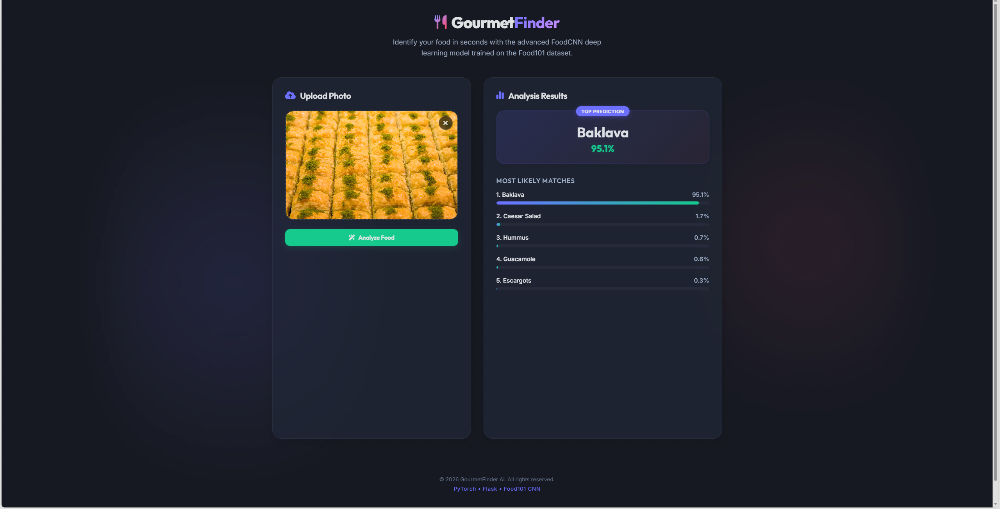
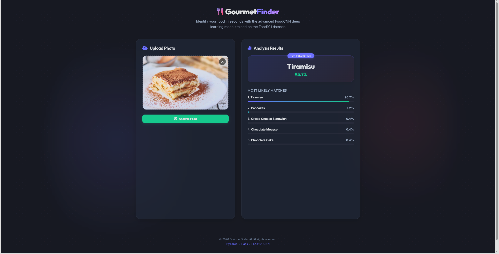
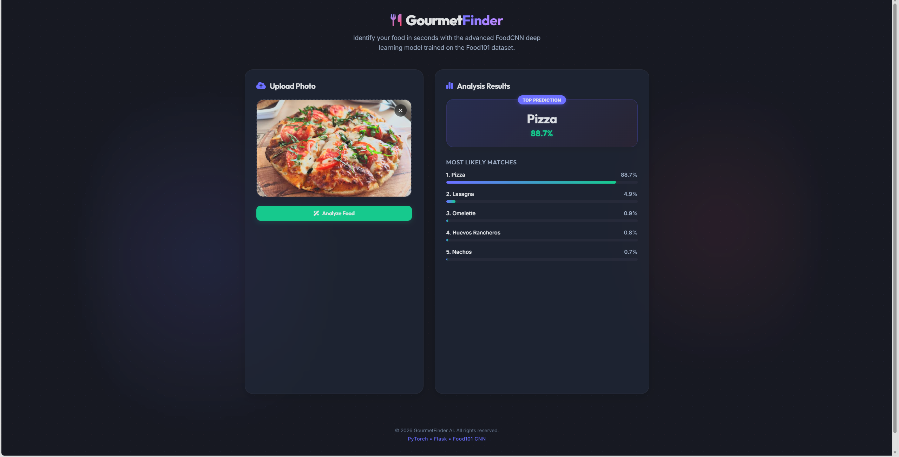

# Food101 Image Classification



A deep learning image classification project built with PyTorch using a custom Convolutional Neural Network trained from scratch on the Food-101 dataset. The model uses no pretrained backbone or transfer learning.

## Project overview

The core work is a 101-class CNN trained with image augmentation and regularization. A Flask browser application was added later with Codex and Antigravity to load the trained checkpoint and display food predictions; the from-scratch model and training work are distinct from that application integration.

## Visual results

<p align="center">
  
  
</p>

<p align="center">
  
</p>

## Model architecture

The original [training notebook](training/food101-training.ipynb) defines five 3 × 3 convolutional blocks with **64 → 128 → 256 → 512 → 512** channels. Each block applies batch normalization, ReLU, and 2 × 2 max pooling. Adaptive global average pooling feeds a **512 → 1,024 → 101** classifier with ReLU and **0.4 dropout**.

The saved model has **4,542,565 trainable parameters**, counted from the [checkpoint](Food101_CNN_Classification_Model.pth). Inputs are RGB images transformed to 224 × 224 pixels.

## Training configuration

The notebook uses `torchvision.datasets.Food101` with its official **train split (75,750 images)** and **test split (25,250 images)**. It does not create a separate validation split.

| Setting | Recorded value |
| --- | --- |
| Epochs | 50 |
| Batch size | 32 |
| Optimizer | Adam, initial learning rate 0.001 |
| Loss | Cross-entropy with 0.1 label smoothing |
| Scheduler | CosineAnnealingLR, `T_max=50` |
| Training transforms | RandomResizedCrop(224, scale 0.7–1.0), RandomAffine(20°, translation 0.1, shear 10°), horizontal flip, ColorJitter(0.3, 0.3, 0.3, 0.1), tensor conversion, normalization |
| Evaluation transforms | Resize(256), CenterCrop(224), tensor conversion, normalization |
| Normalization | Mean (0.485, 0.456, 0.406); standard deviation (0.229, 0.224, 0.225) |

The recorded notebook ran with Python 3.10.11, PyTorch 2.5.1+cu121, and an NVIDIA GeForce RTX 4060. It does not set a random seed or record a complete locked dependency environment.

## Evaluation results

The training log reports **70.30% accuracy** and **1.8964 loss** on the Food-101 **test split at epoch 50**. The notebook calls these values “Val”, but its dataset declaration uses `split="test"`; the result is therefore test-split accuracy, not accuracy on a separate validation set.

The notebook evaluates that test split after every epoch. Its highest logged test accuracy is **70.44% at epoch 49**, but the code saves the model **after epoch 50**, without best-checkpoint selection. The [included checkpoint](Food101_CNN_Classification_Model.pth) matches the original final-epoch training artifact byte for byte (SHA-256: `853ad1f1ce0cae07e948c6c1a9fe9f3796f98c3fa5494b7653501830bc68c456d`). The 70.30% claim refers to this final checkpoint.

The original notebook retains the epoch output, and [epoch-metrics.csv](training/epoch-metrics.csv) extracts all 50 logged train and test results. Reusing the test split during training makes this a recorded experiment result rather than an untouched, one-time final benchmark.

## Technologies and features

The model and training notebook use Python, PyTorch, Torchvision, and CUDA when available. The repository includes a custom CNN, fine-grained food classification, image augmentation, adaptive pooling, and regularized training. The later Flask interface loads the trained weights for browser-based image predictions.

## Installation and reproduction

Install Python with a compatible PyTorch and Torchvision build, plus NumPy, Matplotlib, and Jupyter Notebook. For a basic environment:

```bash
python -m pip install torch torchvision numpy matplotlib notebook
cd training
python -m notebook
```

Open `food101-training.ipynb` and run its cells in order. From the `training/` working directory, the notebook downloads Food-101 into `training/data/` and saves a new state dictionary under `training/model/`. It does not overwrite the checkpoint in the repository root.

The notebook does not fix all sources of randomness or pin every dependency version, so a fresh run may not reproduce exactly 70.30%. The supplied notebook output, CSV, and checkpoint document the original run.
